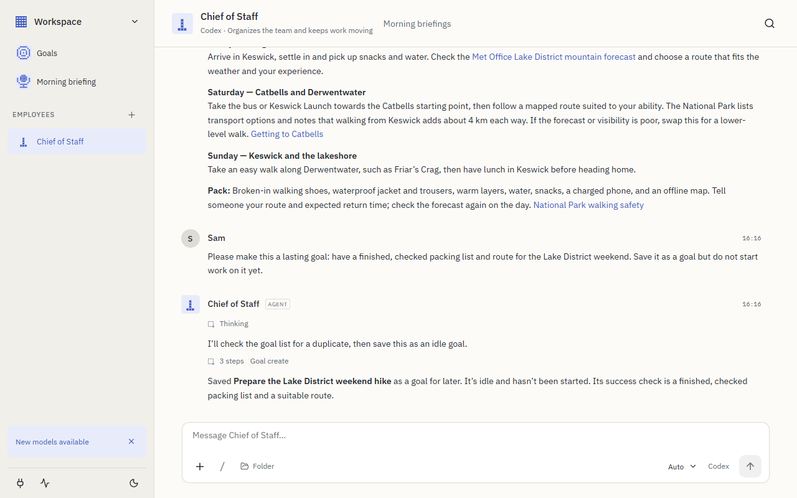
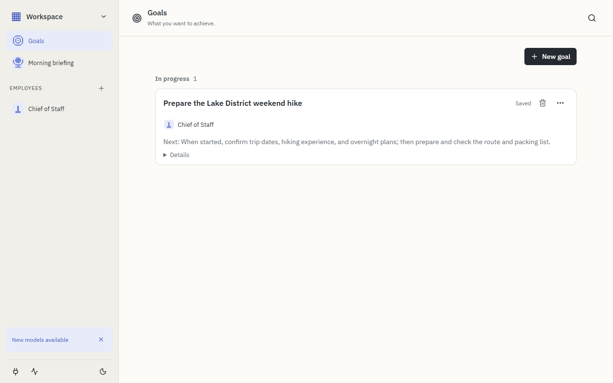

# Abralo

**Your AI company, on your own computer.**

[](https://github.com/cw12574/abralo-workspace/actions/workflows/build.yml)
[](https://github.com/cw12574/abralo-workspace/releases/latest)
[](LICENSE)

Abralo is an open-source workspace where you and a team of AI employees work towards lasting goals. Each employee runs on an agent you already use (Claude Code, Codex or OpenCode), signed in with your own account. A Chief of Staff organises the team, every goal has a lead and a success check, and nothing leaves your machine except the model requests you make.



**[Download](https://github.com/cw12574/abralo-workspace/releases/latest)** · **[Getting started](docs/preview/START-HERE.md)** · **[Release notes](docs/preview/RELEASE-NOTES.md)** · **[Abralo Cloud](https://abralo.com)** (hosted for you)

## Features

- **A team of AI employees.** Each has a name, a role and its own conversation. The Chief of Staff hands out work and keeps it moving.
- **Lasting goals.** A goal has a lead, a definition of success and a next step. Work carries across sessions, and a goal closes only after an independent review against its success check.
- **Morning briefing.** Talk or type with your Chief of Staff to see what moved and agree the day's priorities. Spoken briefings use OpenAI's Realtime API with your own OpenAI API key; typed briefings need nothing extra.
- **Bring your own agent.** Claude Code, Codex and OpenCode are bundled and use your existing sign-in. Abralo never picks a model API you did not choose.
- **Connected tools, with approvals.** Stripe and Railway through their official MCP servers, Gmail with your own Google OAuth client, and other services found in the public MCP registry. Any change to the outside world waits for your approval and is never blindly repeated.
- **Safe with your work.** Git tasks run in their own worktree, agents get an isolated browser per run, and desktop control (Windows) needs a time-limited permission you can revoke.



## Install

Download the archive for your platform from the [latest release](https://github.com/cw12574/abralo-workspace/releases/latest) and follow [Getting started](docs/preview/START-HERE.md).

| Platform | Archive | Install |
| --- | --- | --- |
| Windows 10/11 x64 | `abralo-windows-x64.tar.gz` | `powershell -ExecutionPolicy Bypass -File .\scripts\install-windows.ps1 -ReleaseDirectory .` |
| macOS, Apple silicon | `abralo-macos-arm64.tar.gz` | `xattr -dr com.apple.quarantine . && ./runtime/node scripts/install-posix.mjs` |
| macOS, Intel | `abralo-macos-x64.tar.gz` | as above |
| Linux x64 | `abralo-linux-x64.tar.gz` | `./runtime/node scripts/install-posix.mjs` |

Each archive bundles its own Node.js runtime, Chromium and the agent CLIs. No administrator rights, Docker or Electron are needed. Builds are not yet code-signed; verify downloads against `SHA256SUMS` in the release.

## How it works

Abralo is a local web app: a Node.js service with a SQLite database serves a React interface to your browser on `http://127.0.0.1:4317`.

```
apps/service       Fastify service: API, goals, supervisor, agent adapters, connections, SQLite store
apps/web           React + Vite interface
packages/contracts Shared types and activity helpers
packages/host      Platform helpers: data directory, process launch, executables
scripts/           Packaging, installers, launcher, maintenance and end-to-end checks
tests/             Vitest suite
```

The supervisor runs each employee's turns through an adapter for its engine (`apps/service/src/adapters`). Agents reach Abralo's own tools (goals, team, memory, connections, browser) through an in-process MCP server. Outside actions are recorded as durable approvals before anything runs.

## Develop

Requirements: Node.js 24.16+ (24.x) and pnpm 10.33.4.

```sh
pnpm install --frozen-lockfile
pnpm exec playwright install chromium
pnpm build        # type check, web bundle and service
pnpm test         # Vitest suite
pnpm start        # serve the built app on http://127.0.0.1:4317
```

For development, run `pnpm dev` (service from source, restarts on change) and `pnpm web` (Vite on port 5178, proxying `/api`). Use `WORKSPACE_DATA_DIR` to keep development data separate from a real workspace.

Package for the current platform with `pnpm package release/abralo-<target>`, then check it with `node scripts/verify-package.mjs release/abralo-<target>`. End-to-end checks in `scripts/` cover onboarding recovery, the launcher lifecycle and installation. Scripts that make real provider calls (`workflow-smoke.ts`, `image-smoke.ts`, `live-smoke.ts`) use the signed-in account's allowance; run them only deliberately.

## Configuration

| Variable | Default | Purpose |
| --- | --- | --- |
| `WORKSPACE_DATA_DIR` | see below | Where the workspace database, vault and files live |
| `WORKSPACE_PORT` | `4317` | Local port |
| `WORKSPACE_HOST` | `127.0.0.1` | Bind address. Anything else requires `WORKSPACE_PUBLIC_URL` |
| `WORKSPACE_PUBLIC_URL` | unset | The `https://` address of an authenticated reverse proxy, for remote access |

Default data directory: `%LOCALAPPDATA%\AgentWorkspace` on Windows, `~/Library/Application Support/AgentWorkspace` on macOS, `$XDG_DATA_HOME/AgentWorkspace` (or `~/.local/share/AgentWorkspace`) on Linux. Program files and data are kept separate; reinstalling keeps your workspace. Never put a live database in a synced folder such as OneDrive or Dropbox.

## Security and privacy

- **Local by default.** The service listens on loopback only and refuses requests whose `Host` is not the local machine (DNS-rebinding protection) or whose `Origin` is foreign. Every state-changing request needs a custom header, and the session cookie is `HttpOnly` and `SameSite=Strict`. Remote access requires HTTPS behind your own authenticated proxy.
- **Your accounts stay yours.** Agents sign in through their own CLIs; credentials never pass through chat. Connection secrets go to an AES-256-GCM vault whose key is protected by DPAPI on Windows and kept in a user-only file on macOS and Linux.
- **Approvals before action.** External changes wait for an explicit decision, and an approved action runs exactly the saved arguments once.
- **No telemetry.** Abralo sends nothing to us. Model requests go to the agent provider you chose; spoken briefings go to OpenAI with your key; connections talk only to the services you connect.
- **Dependencies** are pinned and audited in CI (`pnpm audit`).

Agents act with the permissions you give them. Start new employees in **Ask** mode, and read [access and privacy](docs/preview/ACCESS-AND-PRIVACY.md). Report vulnerabilities privately as described in [SECURITY.md](SECURITY.md).

## Contributing

Issues and pull requests are welcome. Please read [CONTRIBUTING.md](CONTRIBUTING.md) first; for anything substantial, open an issue to discuss it.

## License

[Apache-2.0](LICENSE). Bundled third-party packages keep their own licenses, and the native agent CLIs remain subject to their vendors' terms.
